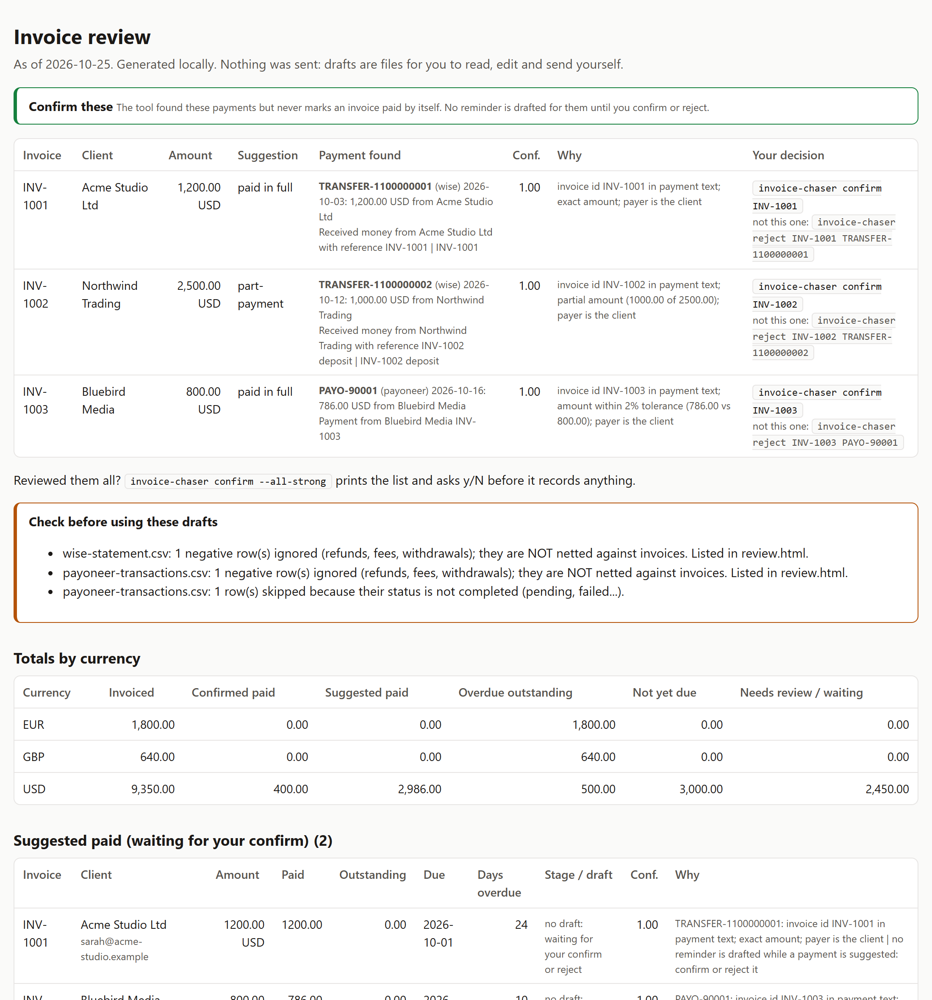
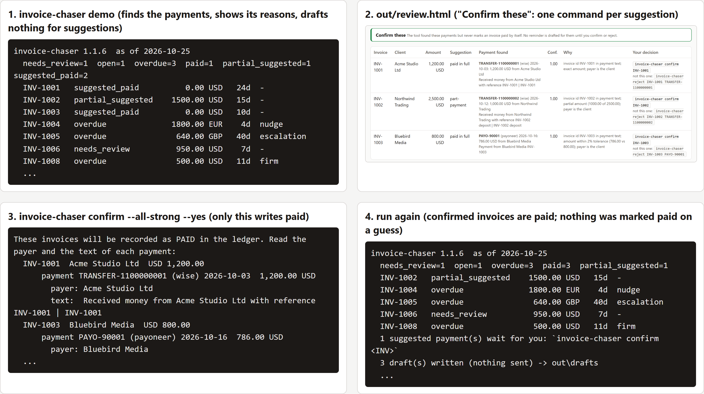

# invoice-chaser: match payments to open invoices and draft polite overdue reminders, locally


**The client is three weeks late, chasing feels awkward, so you don't, and the money sits.**

**It finds the payments, you confirm with one command. It never marks paid on a guess, never chases a client who paid.**

| What it will not do | What it does instead |
| --- | --- |
| Mark an invoice paid by itself | Suggests it with the exact payment row and the reason. Only `confirm` writes "paid". |
| Chase an invoice that has a suggested payment | Waits for your confirm or reject, and flags it STUCK after 7 days so it cannot hide. |
| Trust a refund, a failed or a repeated payment | Holds it in "needs review" and says why. |
| Send an email | Writes `.eml` drafts for you to read, edit and send. |
| Upload anything | Everything stays on your machine. No account, no SaaS login. |

```bash
git clone https://github.com/waseemnasir2k26/invoice-chaser.git && cd invoice-chaser
pip install .
invoice-chaser demo
```

Open `out/review.html` (macOS `open`, Windows `start`, Linux `xdg-open`): the top of the page has one copy-paste command per suggested payment. Python 3.10+, no dependencies.





Point this at your invoice list and your Wise, Payoneer or bank export. It matches payments to invoices and shows each match with its reason and the exact payment row. You review the list and confirm what is right. It writes a reminder draft, in the right tone for how late the invoice is, only for invoices where it found no payment at all. It never sends anything, and nothing leaves your machine unless you turn on `--llm` (then first name, amount, days overdue and invoice id go to the provider you choose): no account, no SaaS login.

It never suggests paid on a near match of an id or a name: 3,360 adversarial cases in the test suite (near-miss ids and names, refunds in many languages, failed payments, future dates, shared prices). Each scenario is executed and logged by `tests/test_adversarial.py`, and a test compares that logged count with this number. To see the measured count, run `pytest -s tests/test_adversarial.py -k readme_states`. One deliberate exception: a payment that carries your exact invoice id is suggested even if the payer is someone else (you see the payer and decide). If it is not sure it says why and waits for you, and a waiting suggestion never hides an unpaid invoice for long: see "stuck" below.

The top of the page, "Confirm these", has one copy-paste command per suggested payment; `invoice-chaser confirm --all-strong` shows the list and asks y/N. Python 3.10+, no dependencies. For your own data: `invoice-chaser run --invoices invoices.csv --wise wise.csv --out out` (details below).

## What it does

1. Reads `invoices.csv` plus one or more payment exports.
2. Looks for the payment behind each invoice and gives every candidate a reason and a confidence.
3. Sorts every invoice into one of: **suggested paid** and **part-payment suggested** (strong evidence, waiting for you), **needs review** (weak or conflicting evidence), **overdue** (no payment found), **open** (not due yet). **Paid** only ever appears if invoices.csv says so or you ran `confirm` / `mark-paid`.
4. Drafts a reminder only for **overdue** invoices (and for the rest of a part-payment you confirmed). Never in `drafts/` for an invoice with a suggested payment; after the stuck window (`stuck_after_days`, default 7) a `[CHECK FIRST]` draft is written to `drafts/check-first/` so an unpaid client is never silently dropped. Those suggestions wait for your `confirm` or `reject`, so a wrong suggestion cannot cause a reminder to a client who paid. A waiting suggestion does not park an unpaid invoice for ever: after `stuck_after_days` (default 7), or at once when the invoice is already more than 30 days overdue, it is flagged **STUCK** at the top of `review.html` and in the command-line summary, and a "check this one" note is drafted to YOU (never to the client). Rejecting the suggestion, or `mark-paid`, ends the wait. A STUCK invoice that has also waited longer than `stuck_after_days` and is more than `stuck_overdue_days` overdue gets the normal client reminder for its stage too, but written to **`out/drafts/check-first/`** (never `out/drafts/`): the first line says `CHECK FIRST: a possible payment was found (...)` and names that payment, and the subject starts with `[CHECK FIRST]`. Verify the payment before you send it, then record it with `mark-sent --checked`. Never for an invoice held as a payment that backs two invoices, as a possible double count, or as a refund-looking client name: the money may already have arrived. Such an invoice that has passed the stuck window gets a CRITICAL `STUCK_HOLD` line on every run, naming the invoice and its days overdue, and `run` exits 2 until you decide. Any held invoice more than `stuck_overdue_days` (default 30) overdue gets a CRITICAL `OVERDUE_HELD` line on every run, the first time it is seen too, with its days overdue and the exact commands that resolve it; `run` exits 2 until you decide.
5. Writes `out/status.csv`, `out/review.html`, `out/suggestions.json`, `out/drafts/*.eml` (client reminders) and `out/drafts/internal/*-check.eml` (notes to you, never to a client).

Drafts are always for you to read, edit and send yourself. Nothing is emailed; the code contains no mail-sending path, and a test fails if one appears.

## Sample output

From `invoice-chaser demo` (synthetic data, dated 2026-10-25). The blocks below are generated by `scripts/update_readme_samples.py`, and a test fails if they drift from the real output.

<!-- sample:demo-output -->

```
invoice-chaser 1.1.15  as of 2026-10-25
  needs_review=1  open=1  overdue=3  paid=1  partial_suggested=1  suggested_paid=2
  INV-1001   suggested_paid          0.00 USD   24d  -
  INV-1002   partial_suggested    1500.00 USD   15d  -
  INV-1003   suggested_paid          0.00 USD   10d  -
  INV-1004   overdue              1800.00 EUR    4d  nudge
  INV-1005   overdue               640.00 GBP   40d  escalation
  INV-1006   needs_review          950.00 USD  held: possible payment found but it is not certain: no reminder drafted until you check  -
  INV-1008   overdue               500.00 USD   11d  firm
  3 suggested payment(s) wait for you: `invoice-chaser confirm <INV>` or `confirm --all-strong`
  3 draft(s) written (nothing sent) -> out/drafts
  out/status.csv
  out/review.html
  (demo starts from a fresh ledger every run; add --keep-ledger to keep your confirm / mark decisions between runs)
```

<!-- /sample -->

`INV-1001` and `INV-1003` are suggested as paid: `INV-1003` arrived as 786 of 800 through Payoneer (fees) and still counts, because the invoice id is in the payment. `INV-1002` is a part-payment suggestion (1,000 of 2,500). `INV-1006` has a 950 payment under a different name and no reference, so it is only "needs review". None of those four gets a reminder: they wait for you. `INV-1004`, `INV-1005` and `INV-1008` have no payment at all, so they get drafts.

One draft (`out/drafts/INV-1005-escalation.eml`; it opens in a mail client as an unsent message). It mentions the earlier reminder because `invoices.csv` has a `last_reminder` date for it:

<!-- sample:eml -->

```
To: tom@harborco.example
From: Alex Rivera <alex@example.com>
Subject: Invoice INV-1005: let's resolve this (40 days overdue)
X-Unsent: 1

Hi Tom,

Invoice INV-1005 for 640.00 GBP is now 40 days overdue. This follows my reminder of 2026-10-05.

Payment details are on the invoice. Wise or Payoneer both work.

Could we speak this week? If a payment plan would help, tell me what is realistic and I will consider it. Otherwise I will need to review next steps for this account.

Thank you,
Alex Rivera
```

<!-- /sample -->

## How matching decides

**The tool never sets an invoice to paid on its own.** A false "paid" would mean a client is never chased; a wrong "overdue" would mean a reminder to someone who paid. No rule set can promise zero of either on messy bank text, however many rules are added, so the decision is split:

- the **engine** ranks evidence and shows its work (a suggestion with the reason, the confidence and the exact payment row);
- **you** decide with `invoice-chaser confirm INV-1` (or `confirm --all-strong` after reading the list). Only that writes "paid" to the ledger (`out/sent.json`).

Strong evidence, which becomes a suggestion, exists in exactly two forms.

| | Path A: invoice id | Path B: the client itself |
| --- | --- | --- |
| Amount | within the fee/FX tolerance, in the invoice currency (or via a configured rate). Lower = **part-payment** suggestion. Higher = needs review | exact, same currency |
| Who | exactly ONE invoice id in the payment, as a whole token. Path A trusts the id, not the payer: a payment that carries your invoice id is suggested even if the payer name is different | payer words = client words (any order, same word counts), same legal-suffix kind: Acme Ltd = Acme Limited, but Acme Ltd != Acme Inc != Acme |
| The text | it names no other invoice, and no id-like token (INV-9999) that is missing from your invoice list | it names no invoice at all |
| Never | refund, failure or non-receipt wording (below) | the same; and no other invoice of that client at the same price (settled ones count), and no second client with the same name |

What "whole token" means: `INV-1004`, `inv 1004`, `INV#1004`, `(INV-1004)`, `INV-1004.` all count. `INV-1004/2`, `INV-1004.5`, `INV-1004-2`, `INV-1004A`, `XINV-1004`, `INV-10040` and `INV 1004 2` do not. The description and the payer are searched separately, never glued together, and ids inside e-mail addresses and URLs do not count. An id must look like an id: at least 2 letters and 2 digits (`INV-12`, `AB1234`), or start with a prefix in `ref_prefixes` (default `INV` and `INVOICE`, so `INV-1` works); an all-digit id needs 4+ digits and a configured prefix (`INV 2026001`). `A7`, `B2`, `5` and `2024` never count, so "Vitamin B2" and "Deposit for 5 hours" cannot point at an invoice.

Wording that disqualifies a payment: refund, reversal, failure and non-receipt words in about twenty languages (list below, generated from the code, so it cannot drift). It is a long list, not a complete one: anything that slips past it still only becomes a suggestion that you confirm. Short words match only as whole words, so a client called Stornoway, Returnly, Voidstar, Kreditech, Re or Un is not mistaken for a refund. The client's name is never cut out of the text. A client whose own name contains one of these words (Refund Ltd, Pending Ventures, Chargebacks911) is never matched automatically: the row says "client name contains a refund word: please check".

<!-- sample:negative-words -->
```
Whole words (the word must equal the entry, any case):
  afgewezen, annulation, annullato, annulé, annulée, anulacion, anulación, anulado, anulowane, avoir, başarısız, blocked, bounce, bounced, cancel, cancelado, canceled, canceling, cancellation, cancellations, cancelled, cancelling, cancels, chargeback, chargebacks, clawback, creditnota, decline, declined, declines, denied, devolucao, devolucion, devoluciones, devolución, devolução, devolvido, devuelto, dibatalkan, dispute, disputed, disputes, ditolak, echoué, estornado, estorno, fail, failed, fails, failure, failures, falhou, fallido, gagal, geannuleerd, iade, iadesi, impago, impayé, impayée, insoluto, iptal, mislukt, nsf, odrzucone, overdraft, pendente, pendiente, pending, rechazado, recusado, reddedildi, reembolsado, reembolso, reembolsos, refund, refunded, refunding, refunds, refusal, refused, reimburse, reimbursed, reimbursement, reject, rejected, rejects, rejeté, rejetée, repaid, repayment, respinto, restitutie, restitution, restituzione, retour, retourné, retournée, retours, return, returned, returning, returns, reversal, reversals, reverse, reversed, reverses, reversing, rimborsato, rimborsi, rimborso, rueckbuchung, rueckgabe, rückbuchung, rückgabe, storna, stornieren, storniert, stornierung, stornierungen, storno, terugbetaald, terugbetaling, teruggestort, unpaid, unsuccessful, void, voided, vráceno, vrácení, zamítnuto, zrušeno, zwrot, zwrotem, zwrotu, zwroty, zwrócono, échoué, возврат, возврата, возвраты, возвращен, возвращён, отклонен, отклонён, отмена, отменен, отменён, ביטול, החזר, ارتجاع, استرداد, بازپرداخت, برگشت, فشل, مرتجع, مرفوض, ملغي, منسوخ, ناکام, واپسی
Long stems (found inside a word, to cover inflections):
  rückerstattung, rueckerstattung, erstattung, rückzahlung, rueckzahlung, rücklastschrift, rucklastschrift, gutschrift, stornierung, remboursement, annulation, restitution, reembolso, reembolsad, devolución, devolução, rimborso, rimborsat, terugbetaling, terugbetaal, creditnota, återbetalning, tilbagebetaling, tilbakebetaling, pengembalian, pembatalan, rambursare, visszatérítés, palautus, chargeback, reimburse, refunded
Scripts written without spaces, and phrases in other languages (found anywhere in the text):
  返金, 返品, 払い戻し, 払戻, 退款, 退费, 退費, 退货, 退貨, 退还, 환불, 반품, คืนเงิน, वापसी, ফেরত, επιστροφή, החזר, استرداد, بازپرداخت, واپسی, возврат, hoàn tiền, hoan tien
English phrases (the words in a row):
  money back, on hold, not paid, not completed, not received, not yet received, was not received, did not go through, didn t go through, wasn t received, could not be processed, payment failed, insufficient funds, credit reversal
Credit notes: the word 'credit' followed by one of:
  memo, nota, note, notes
```
<!-- /sample -->

Everything else is **needs review**: no suggestion to confirm, no reminder drafted, and `status.csv` / `review.html` say exactly why in a *why not paid* column (for example `payer 'Acme Holdings' is not exactly 'Acme'`, or `the payment names several invoices (INV-1, INV-2)`). Each such row shows a copy-paste `invoice-chaser mark-paid INV-1006` for when you have checked yourself. Also held for review, never guessed:

- the same payment seen in two exports under different payer names ("Acme Ltd" in Wise, "Jane Okafor" in the bank file): same amount and currency, within two days, from two different exports, and the same invoice id named in both (or both payers blank). Both are held in needs review. Name the one you checked with `invoice-chaser confirm INV-9 --payment <id>` (name both if both are real); it never counts the invoice twice;
- (Once you have named the payment with `--payment`, those payments are consumed and the hold does not fire again; the other half of the pair is printed with the exact `reject` / `confirm` commands.)
- a duplicate invoice id (case differs): two invoices whose ids differ only by capitals (`INV-6001` and `inv-6001`): both wait in needs review, with no reminder to either client, until you give them unique ids. `mark-paid`, `confirm`, `reject` and `mark-sent` refuse such an id ("invoice ids are not unique") until invoices.csv is fixed;
- a payment that names more than 3 invoices (it is never paired with any of them), or an invoice named by more than 20 payments;
- a possible duplicate: the same transfer id twice in one export (the second row is dropped, with a warning), or the same amount, currency, payer and date (plus or minus one day) in two exports (both flagged);
- a payment dated before the invoice was issued, far after it, or in the future. Never dropped silently: listed in `review.html` as "payments outside the invoice date window (check date format)", because a day/month mix-up is the usual cause. Use `--date-format dmy|mdy|ymd`; if every date in a file could be read either way, you get a warning.

**Shared prices.** If you charge everyone 500 and a stranger's 500 arrives with no invoice id, that payment could belong to any of your clients. The tool does not guess and does not chase: the invoice goes to **needs review**, with the payer named in the reason. With more than 20 payments of the same amount and nothing identifying yours, it says so in one line instead of listing them. The cost is a few extra rows to look at; the alternative is a reminder to a client who already paid.

**What you confirm is remembered, and checked.** `confirm` and `mark-paid` store a snapshot of the invoice (client, amount, currency, due date). If `invoices.csv` later differs, the invoice goes back to **needs review: invoice changed since you confirmed it**, with a warning, instead of staying paid.

Confidence (0 to 1) is only for ordering and display. Partial payments add up: confirm 1,000 against a 2,500 invoice and the next run chases the remaining 1,500; when the rest arrives it is suggested against what is left.

Currencies are read as ISO codes (`usd ` becomes `USD`, `€` EUR, `£` GBP). A bare `$` is not guessed: set `default_currency` in the config, otherwise you get a warning and those rows match nothing. Negative rows (refunds, fees, withdrawals) are ignored with a warning and listed in `review.html`; they are not netted against invoices.

**Amounts are read strictly.** Sign or (parentheses), an optional currency symbol or code, then digits with one consistent thousands separator (comma, dot, space or apostrophe, always groups of three) and at most one decimal mark. `1,234.56`, `1.234,56`, `12,50`, `USD 1 234,50` are read exactly. Forms that could mean two things (`1,234` is 1234 or 1.234; `1.500` is 1500 or 1.5) and anything malformed (`1e400`, `1000 (2 of 3)`, `1,23,456`) skip that row with the reason, instead of guessing. Say which you mean with `decimal_comma` in the config (`true` for 1.234,56 style, `false` for 1,234.56) or `--decimal-comma`; it applies to the invoice, Payoneer and bank files, while Wise statements always use a decimal point.

Speed: candidates per invoice are bounded, never an all-pairs scan. Exactly: payments that name the invoice id (a payment naming more than 3 known ids is never paired; an invoice named by more than 20 payments goes to review in bulk); payments from a payer equal to the client inside the date window (the 20 nearest the due date); payments with the exact invoice amount, only when there are at most 20 of them (otherwise review in bulk). Measured cold, one run each, single thread, on a Windows 11 laptop (Intel 13th-gen-class CPU, 24 logical cores, Python 3.11.9) with synthetic data from `tests/perfdata.py` (500 distinct client names, so about 6 invoices and 30 payments per client, denser than most real exports): 60 invoices x 600 payments 0.03 s; 500 x 3,000 0.21 s; 1,000 x 5,000 0.39 s; 3,000 x 15,000 1.4 s; 6,000 x 30,000 2.2 s. Worst cases checked by tests: one price for every invoice (1,000 x 5,000) under 5 s, and every payment naming every invoice (500 x 2,000) under 3 s. Your numbers will differ.

**Payment ids: the exact rule.** A payment's id is its real transaction id when the export has one. Otherwise it is a hash of the source, date, amount, currency, the description (punctuation, capitals and spacing ignored) and the payer as a company (`ACME LTD` and `Acme Limited` are the same company; `Acme Inc` is not), plus an occurrence index that counts only rows with exactly that same full key. It is never a row number, and it never depends on how many other rows exist: a lone row keeps its id when a same-day sibling from someone else shows up in a later export. If any of those fields changes (the bank rewords the description, a different company name), the id changes, and the repeat check below holds the payment instead of trusting it. Consuming a confirmed payment, honouring a rejection and confirming a new one all require the same id AND the same date, amount, currency and payer. Any mismatch (a bank reusing a transaction id, two payments that once shared an id) is held in needs review with a loud warning and the next step; it is never silently dropped.

## The re-export trap and how it is handled

You download the statement again next week. The file now has new rows, a different order, maybe slightly different wording. Anything that remembers a payment by its position (row 7) would now point at a different client's payment. Here is what keeps that from hurting you:

- **Payment ids never use the row number, and never depend on the other rows.** See the exact rule above: the same payment keeps the same id whatever else appears in the export, so new rows, a different order or a same-day sibling change nothing.
- **A repeat is recognised even when the wording changed.** When you confirm a payment, the ledger remembers its date, amount, currency and payer. If a later export shows a payment within a day of that date with the same amount, currency and company but a new id, it is held in **needs review** as "possible repeat of a payment you already confirmed": never counted again, never suggested as new, and `confirm` refuses it. It is NOT a repeat when the bank gave the two payments different transaction ids or the text names a different invoice. A genuine second payment of the same amount a week later is a different date and is suggested normally.
- **Identical rows stay separate, but are flagged.** Two genuinely identical payments in one file are two payments. An identical row that shows up in two different exports (or the same file given twice) is kept, not merged, and held for review: one real payment or two? You decide.

## Orphaned decisions: it never repairs, it asks

A decision you made (a confirmed payment, a rejected payment, a confirmed invoice) can end up pointing at something that is not in today's data: the bank changed how it words or numbers a payment, or you renamed an invoice id in `invoices.csv`. The tool never repairs that for you. Re-attaching a decision automatically is how a confirmation ends up on a different client's payment, and a paid client gets chased. Instead:

- if a **look-alike** exists (same date, amount, currency and payer company for a payment; for an invoice, any current invoice that may be it renamed or edited: the same client, ignoring capitals, punctuation, spacing and the legal suffix; or the same amount and currency; or an id within two edits of the old id), you get a critical `ORPHANED_DECISION` warning. It lists what you decided, the invoice snapshot, the look-alike candidates with a safety check (a payment that names another invoice, or carries a different bank transaction id, fails it), and the exact commands;
- the invoices involved, and any invoice a candidate names, are held in needs review with **no reminder** until you resolve it. A renamed-and-edited invoice (say `Renamed Co` to `Renamed Co.` with a new amount) is caught by the same client, the same amount, or the near id: the rule is deliberately wide, so one orphan can hold several similar invoices. Each one gets its own `rebind` or `forget` line, and `forget` clears them all for a decision that was never about them; The candidates are never suggested for anything meanwhile;
- `invoice-chaser rebind <old> <new>` attaches the decision to the new payment (or the renamed invoice), after the same checks as the repeat check, and refuses if they fail;
- `invoice-chaser forget <old>` drops the stale decision.

If a confirmed payment is simply not in today's exports (a shorter or newer statement) and nothing looks like it, nothing is wrong and nothing is said.

**Candidates come from today's exports.** `rebind`, `forget` and `orphans` re-read the exports of the last run (same files, same options) and look for candidates at the moment you run them. Nothing is taken from a saved list, so a candidate that has since gone away is never offered. An invoice rename is keyed by kind, old id and new id: two identical invoices renamed `X1` and `X2` give two rows, `invoice-chaser rebind INV-A X1` takes one, and resolving it drops A's other candidate row. `invoice-chaser orphans` lists every pending orphan with its exact commands.

**Nothing is overwritten.** `rebind` and a renamed invoice id are refused if the target already has a decision (a confirmation, a rejection or a sent reminder on the target id, or a payment that already backs an invoice or is already rejected). The message says what is there; you look at it, then `forget` the stale one.

## One payment backs one invoice

A payment key can back at most ONE invoice in the ledger. This is checked on every `run` and before every ledger write:

- If the ledger ever shows one payment behind two invoices, `run` prints a **CRITICAL `PAYMENT_DOUBLE_BOUND`** warning naming both invoices and the payment, and holds both invoices (`held:` in the list, no reminder, not counted paid). It prints the command for each invoice: `invoice-chaser unbind <invoice> <payment>`.
- `invoice-chaser unbind INV PAYMENT` removes that invoice's confirmation for that payment. The invoice goes back to a fresh suggestion, and the other invoice keeps its own confirmation. It can only send an invoice back to review; it never marks anything paid.
- `confirm` and `rebind` refuse a payment that already backs any invoice, and say which one.
- `confirm --payment` and `rebind` refuse a payment whose text names a different known invoice (`TRANSFER-1 names INV-A, not INV-C`); `--force` records it with a warning.
- A write is refused, and nothing is written, when it would add a second binding. Existing bindings are removed with `unbind`, which is always allowed.

## Exit codes

| Code | Meaning |
| ---- | ------- |
| `0`  | done; no CRITICAL notice in this run |
| `1`  | nothing changed: the command was valid but the ledger already said so (`nothing changed` is printed) |
| `2`  | an error (bad id, refused change, unreadable input), **or** `run` finished with one or more **CRITICAL** notices |

`run` exits with code **2** whenever a CRITICAL notice exists (an orphaned decision, a payment that could be the same as a confirmed one, a double binding, a STUCK_HOLD, an OVERDUE_HELD, a missing sender (`NO_SENDER`), a dropped invoice row, ...). Scripts and scheduled jobs should treat 2 as "look at review.html before you act". Warnings and routine notices keep exit code 0.

Every command that writes the ledger reads the file back afterwards and checks that the change is there; if it is not, it says so and exits with an error instead of reporting success.

## The overdue ladder

| Days overdue | Stage        | Intent                                                            |
| ------------ | ------------ | ----------------------------------------------------------------- |
| 1            | `nudge`      | Friendly reminder, assumes it slipped through                     |
| 7            | `firm`       | Asks for a payment date                                           |
| 14           | `final`      | Final reminder with a reply deadline                              |
| 30           | `escalation` | Asks for payment or a written plan, says you'll review next steps |

Templates are plain files, `invoice_chaser/templates/<stage>.<tone>.md`: four stages, three tones (`friendly`, `neutral`, `firm`). Edit them freely, or point `--templates` at your own folder. Variables: `{{first_name}} {{client}} {{invoice_id}} {{amount}} {{outstanding}} {{currency}} {{due_date}} {{days_overdue}} {{sender_name}} {{payment_details}} {{personal_line}} {{reply_days}} {{earlier_reminder}}`. A misspelled variable stops the run instead of shipping literal braces.

**Drafts never claim history you didn't confirm.** Out of the box a draft says nothing about earlier reminders or paused work. Two things unlock that wording:

- _Earlier reminders:_ `invoice-chaser mark-sent` (below), a `last_reminder` date column in `invoices.csv`, or `"previous_reminders": true` in the config. The draft then adds "This follows my reminder of 2026-10-05."
- _Pausing work:_ `"pause_work_on_final": true` adds a pause-work sentence to the `final` and `escalation` drafts. Only turn it on if that is what you will do. The demo leaves it off, so the sample below shows the defaults.

The text does not threaten legal action. Add that yourself where it is appropriate.

## Your decisions: `confirm`, `reject`, `mark-paid`, `mark-sent`

```bash
invoice-chaser confirm INV-1002              # accept the suggested payment (a part-payment is recorded as a part-payment)
invoice-chaser confirm --all-strong          # list every strong suggested-paid invoice, ask y/N (--yes to skip the question)
invoice-chaser reject INV-1002 W1            # that payment is NOT for this invoice: never suggested for it again
invoice-chaser confirm INV-9 --payment W9    # you name the payment(s) yourself; also works on a held suggestion. If two exports use the same id, say wise:W9 or bank:W9
invoice-chaser orphans                       # list pending orphaned decisions with the exact commands (today's exports)
invoice-chaser rebind <old> <new>            # you decided an orphaned decision belongs to the new payment / renamed invoice (checked first)
invoice-chaser forget <old>                  # drop an orphaned decision
invoice-chaser unbind <INV> <payment>        # this payment does NOT back that invoice: remove its confirmation (see "One payment backs one invoice")
invoice-chaser mark-paid INV-1006 --note "checked bank"   # you checked yourself; no suggestion needed
invoice-chaser unmark-paid INV-1006          # changed your mind
invoice-chaser mark-sent INV-1005            # you sent that reminder: the stage is not drafted twice
```

All write `out/sent.json` (override with `--ledger`), then re-run `invoice-chaser run` to refresh the page. Ids are matched ignoring case and spaces. An id that is not in `out/status.csv`, a missing `status.csv`, or a date in the future is refused unless you fix it (or pass `--force` for the first two). `confirm` only works for a strong suggestion from the last run; for anything weaker use `mark-paid`. The ledger is written under a lock with an atomic replace, so parallel runs cannot lose each other's entries. `confirm` only works on the day of the run, on unchanged exports and an unchanged ledger for that invoice (reject, confirm or mark-paid in between means: run again), so a stale `suggestions.json` can never settle anything. `rebind`, `forget`, `unbind` and `orphans` do not depend on the day: they use the exports as they are now. `invoice-chaser demo` starts from a fresh ledger on every run; use `demo --keep-ledger` to try confirm and mark-paid across runs. Files written for you to share contain file names only, never folder paths: `review.html`, `status.csv`, `suggestions.json` and the drafts. The full paths that `confirm` needs to re-check your exports are kept in `out/local-state.json`, for this computer only. The ledger has a schema version (`sent.json` and `seen.json` both say `"schema": 1`). A file without one, or with an older or unknown one, is refused with a clear message and never guessed at; `invoice-chaser ledger reset --backup` starts fresh and keeps a copy. Future versions will migrate old ledgers by fingerprint (date, amount, currency, payer), so your decisions survive a change in how payment ids are made. Today nothing is repaired for you (see "Orphaned decisions" below), and `invoice-chaser ledger reset --backup` refuses a path with no ledger in it, never overwrites an earlier backup, and compares the copy byte for byte with the original before it resets anything.

- **confirm:** records the invoice as paid (or the part-payment as received) with the exact payment ids and a snapshot of the invoice. The payments are used up: they are not suggested for another invoice.
- **reject:** the next run does not suggest that payment for that invoice again, so the invoice is chased (or shows its next candidate).
- **mark-paid:** the next run shows the invoice as paid, with your note, and drafts nothing for it. A second mark-paid prints "nothing changed: ... already marked paid" and exits 1. If a confirmed payment with the same client and amount already backs another invoice, mark-paid first prints a `WARNING: payment ... already backs INV-x`; it is a warning only, and the mark-paid is still recorded.
- **mark-sent:** a stage you already sent is never drafted again (the review page says when the next stage starts), and the next draft is worded as a follow-up with the date of your last reminder.
- **One gate for every client draft.** Every reminder addressed to a client, normal or CHECK FIRST, passes the same check (`client_draft_allowed` in `invoice_chaser/gate.py`). It refuses an invoice that has a confirmation or mark-paid while it is held, an invoice an orphaned decision names, an invoice held as a payment that backs two invoices, a possible double count, or a refund-looking client name, and a current invoice that may be a renamed or edited confirmed invoice (the confirmed id is gone and the invoice has the same client, the same amount and currency, or an id within two edits): the same test that raises the orphan hold, so a client is never chased on it.
- **The internal folder:** `out/drafts/internal/` holds the `-check.eml` notes to you ("check this one", "confirmed paid but changed"). They are never client drafts. Nothing in `drafts/` itself is an internal note. An older note left in `drafts/` from 1.1.10 is removed on the next run if you did not edit it.
- **The check-first folder:** `out/drafts/check-first/` holds the reminders for STUCK invoices (point 4). Send one only after you have verified the possible payment. `invoice-chaser mark-sent <INV> --checked` records it; without `--checked` it is refused.
- **Stale drafts:** if you edited a draft and the invoice later becomes paid, your edited file is moved to `out/drafts/stale/` with a warning. It is never deleted. Edited drafts are remembered in `out/kept.json` so the warning repeats every run until you deal with the file.

## Your own data

```bash
invoice-chaser run \
  --invoices invoices.csv \
  --wise wise-statement.csv --payoneer payoneer-transactions.csv \
  --bank bank-export.csv --mapping bank-mapping.json \
  --config invoice-chaser.json --tone neutral --out out
```

`invoices.csv` columns: `id, client, email, amount, currency, issued, due`; optional `status` (`paid`/`void`), `contact` (first name for the greeting) and `last_reminder` (date). Invoice ids should look like `INV-1004` (see above). See `invoice_chaser/demo_data/` for working samples.

| Source                    | Flag                   | Notes                                                                                                                                    |
| ------------------------- | ---------------------- | ---------------------------------------------------------------------------------------------------------------------------------------- |
| Wise statement CSV        | `--wise`               | `Date`, `Amount`, `Currency`, `Description`, `Payment Reference`, `Payer Name`, `TransferWise ID`. Positive amounts only.                |
| Payoneer transactions CSV | `--payoneer`           | Finds date, amount, currency, description, status and id columns by alias. Pending, failed and negative rows are skipped.                |
| Any bank CSV              | `--bank` + `--mapping` | You name the columns in a small JSON file (`bank-mapping.json`). Supports a separate `credit` column, `date_format`, `default_currency`. |

Header matching ignores case, spaces and punctuation, and quoted multi-line fields are read correctly. A missing required column produces an error listing the headers found.

**Verify your own export.** The Wise column names are written from memory of Wise's statement CSV and were not checked against a fresh export; the Payoneer parser guesses by alias and its sample is synthetic. If your export uses different names, the generic `--bank` mapping works for any CSV and takes a minute to write. Please open an issue with the (redacted) header row if a real file fails.

Config (all keys optional, validated with clear errors): `sender_name`, `sender_email`, `payment_details`, `tone`, `fx_tolerance_pct` (0-20), `date_window_days`, `review_threshold`, `auto_threshold` (ordering only), `stage_days`, `fx_rates`, `bank_mapping`, `default_currency`, `ref_prefixes` (default `["INV", "INVOICE"]`), `decimal_comma`, `previous_reminders`, `pause_work_on_final`, `reply_within_days`, `stuck_after_days` (default 7), `stuck_overdue_days` (default 30). JSON files may carry a BOM. If `sender_email` is missing you get a CRITICAL `NO_SENDER` line on every run (`run` exits 2), a banner in `review.html`, and drafts are still written with the placeholder From address.

Invoices with a missing or invalid email get no draft. They show as "missing email" or "invalid email" in `status.csv` and `review.html`, with a warning on stderr. CSV files may be UTF-8, UTF-8 with BOM, UTF-16 or Windows-1252.

## Optional: one personalised line

`--llm` with `GROQ_API_KEY` or `GEMINI_API_KEY` set asks a free-tier model for one opening sentence (`{{personal_line}}`). The request contains only the contact's first name (letters only, at most 3 words and 30 characters, so punctuation and control characters from your CSV cannot reach the prompt), the outstanding amount, days overdue and the invoice id. No email address, no company name, no other invoices. Without a key (a one-line notice tells you) or if the call fails, the template is used as written. Every draft is reviewed by you before it goes anywhere, so a strange sentence is a nuisance, not an incident.

## n8n route

`examples/n8n-weekly.json`: Schedule, Execute Command, Code, Gmail **Create Draft**. It drafts, it does not send. Setup and caveats in [docs/n8n.md](docs/n8n.md).

## Limits

- **It suggests, you decide.** Matching is conservative on purpose, so expect real payments in "needs review": a client paying through a person's name without an invoice id, a fee shortfall without an invoice id, two same-priced invoices for one client paid without ids. Check `review.html`, then `confirm` or `mark-paid`.
- **A payment is only considered** if it names the invoice id, comes from a payer whose name equals the client's, or has the exact invoice amount. A lower payment with no id and a different payer name is not found; it shows up under "Payments not fully matched".
- **Path A trusts the id, not the payer.** Someone else's payment that carries your invoice id is suggested (with the payer shown) and waits for you.
- **Names are compared strictly.** "Zoe" and "Zoë", "Acme" and "Acme Ltd", "Smith & Sons" and "Smith Sons" are different companies as far as the tool can tell. Word order is ignored ("Tom Lee" = "Lee Tom").
- **The refund/failure word list is not complete.** It covers the common payment languages (above), not every language or every phrasing. Anything that slips past it still only becomes a suggestion that you confirm.
- **No bank connection.** You download the statements; nothing logs in for you.
- **Cross-currency needs your rate.** Without an entry like `"EUR/USD": "1.08"` in `fx_rates`, payments in another currency are not matched (and only the invoice-id path accepts a converted amount).
- **A remainder after a part-payment gets its reminder.** Once you confirm a part-payment, the rest of the invoice is still owed and is chased at its normal stage. This is intended (ruled 1.1.11): keep it. The one remainder that is held is the one that looks exactly like a re-export of the deposit (next point).
- **A remainder equal to the deposit is held.** If you confirmed a 500 deposit and the other 500 arrives on the same day with the same payer and no transaction id of its own, it looks exactly like a re-export of the deposit, so it is held in needs review rather than counted. Check your statement; if it really is a second payment, record the invoice with `invoice-chaser mark-paid INV-x`. This costs you one command; the alternative is counting one payment twice.
- **Overpayments** are flagged for review.
- **Reminders are not legal notices.** The text is a starting point for politeness; it is not legal or financial advice, and late-payment rules differ by country and contract.
- **Your edits are safe.** drafts.json stores a hash of every draft it wrote. A draft you edited is never deleted or overwritten: the new one is written beside it as `<name>.new.eml` with a warning. Files that are not ours are never touched.
- A bad row in your CSV is skipped with a warning and the reason (listed in `review.html`); `--strict` aborts instead. An invoice file with no usable rows stops with "no invoices found" and says why.
- Every warning has a CODE and a severity, set where it is raised, never guessed from its text (a payer called "Evil (row skipped)" cannot make anything look routine). **Critical** (`ORPHANED_DECISION`, `ID_COLLISION`, `POSSIBLE_DOUBLE_COUNT`, `INVOICE_ROW_DROPPED`, `DUPLICATE_INVOICE_ID`, `CHANGED_INVOICE`, `NO_SENDER`) and **warning** notices are printed in full with their code; **routine** ones (`NEGATIVE_ROWS`, `ROWS_SKIPPED_STATUS`, kept drafts) are counted, and the summary counts everything by code. A dropped invoice row is always critical and is named by line and id. Everything is in `review.html`. The missing-`sender_email` notice is CRITICAL (`NO_SENDER`) and printed on every run.
- Ambiguous dates like `03/04/2026` are read day-first unless you pass `--date-format`. Timestamps are read as written: a time zone or UTC offset is ignored, so a payment can land a day early or late, which is why matching uses a window of plus or minus one day.
- The LLM call and the n8n workflow were not exercised against live services.

## For you if

- You invoice in USD, EUR or GBP and get paid through Wise, Payoneer or a bank, a few clients at a time.
- You keep invoices in a spreadsheet and don't want an accounting package just to send reminders.
- You want drafts to read and send yourself, not a bot emailing your clients.

Not for you if you need automatic payment collection, payment links, tax handling or a client portal.

## Development

```bash
pip install -e ".[dev]" && python -m pytest
python scripts/update_readme_samples.py     # refresh the README sample blocks
python scripts/make_screenshot.py           # docs/review.png (needs playwright + Chrome)
```

MIT, 2026 SkynetLabs.

---

Need this wired into your business? SkynetLabs builds voice agents, n8n back offices and sites that convert → https://skynetjoe.com
